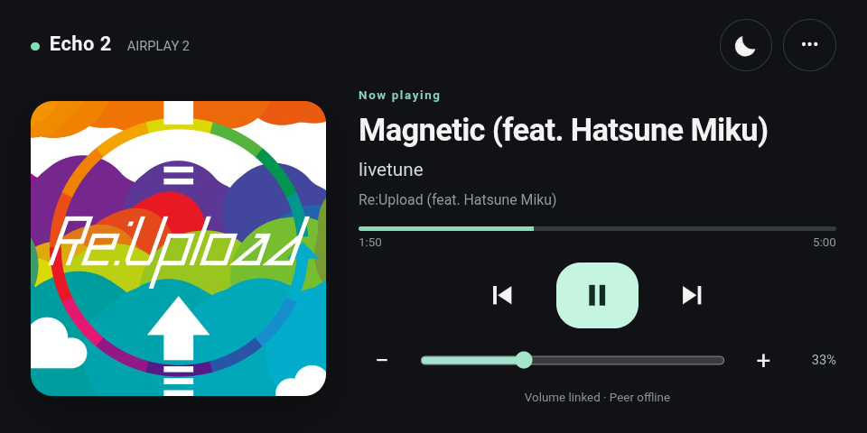

# echo-show5-airplay-touch

An optional touchscreen frontend for an **existing** Shairport Sync receiver.
One device is enough. Playback, pause, track navigation, original album artwork,
progress and volume work without pairing. The Android launcher opens the UI in
full screen and provides a dimmed display mode.

The current Android build is named **Echo AirPlay**. It was tested on Echo Show 5
Gen 2 running rooted LineageOS 18.1, with an Alpine chroot and Shairport Sync
5.6.2. Other Android devices, distributions and receiver versions are not yet
validated. The APK alone does **not** install Shairport, root a device, or set up
an audio driver. The existing terminal UI is independent of this companion.


**One Echo is enough. Multiple devices are optional.**

## On a real Echo



Actual device screenshot: original album art, playback controls, progress and
volume. The optional peer was offline in this capture; a second Echo is not
required. Album artwork and track metadata belong to their respective owners.

## Windows one-click setup

1. Start with an **unlocked Echo Show 5 Gen 2 (`cronos`), LineageOS 18.1 / Android
   11, working Magisk root and USB debugging**. Follow the credited XDA projects
   below for that preparation. This installer never unlocks or flashes a ROM.
2. Download this repository using **Code → Download ZIP**, extract it, connect
   one Echo by USB and authorize the computer.
3. Double-click **`Install.cmd`**. Approve Termux's root request on the Echo if
   Magisk asks. Keep power and USB connected until the installer finishes.

This is an **online installer**, not an offline all-in-one ROM image. For a
fresh device it downloads verified Termux/Alpine/source archives, installs the
runtime and build dependencies, builds Shairport Sync 5.6.2 and NQPTP 1.2.9,
configures PulseAudio/AAudio, installs the included touchscreen APK and boot
hook, then checks the local receiver. Source compilation can take tens of
minutes. Allow at least 1.5 GB free on the device and Internet access on both
the PC and Echo. The PC is not needed after setup.

Existing supported installations use the **upgrade path**, preserving receiver
names, audio configuration and private pairing settings. Fresh installs use a
unique receiver name and **do not enable pairing**. No JDK or Android SDK is
needed to use the included APK. It is the experimental development-signed
build from this source; rebuilding with another key requires handling Android's
signature mismatch yourself. The installer never uninstalls an existing app to
bypass that mismatch.

Read-only prerequisite check, or an explicit ADB path:

```powershell
./Install.ps1 -AdbPath C:/path/to/platform-tools/adb.exe -CheckOnly
./Install.ps1 -AdbPath C:/path/to/platform-tools/adb.exe
```

Without a supplied ADB, normal installation finds it on PATH or downloads
Google's Windows platform tools. Root grants and USB authorization require your
confirmation on the device; the installer cannot bypass them. An existing
non-debuggable Termux build may not support `run-as`; it is left untouched and
the installer reports the failure rather than replacing its data.

See [INSTALLATION.md](INSTALLATION.md) for scope, dependencies, troubleshooting
and validation status. The manual companion-only instructions remain below.

## Credits: the projects that made this possible

**[Shairport Sync](https://github.com/mikebrady/shairport-sync)** by
**Mike Brady and contributors** is the core AirPlay / AirPlay 2 receiver behind
this setup. It provides audio reception, synchronized playback and the metadata
and control interfaces used by this touchscreen companion. Thank you to its
authors and community for making this project possible. This repository adds
the touchscreen interface and optional volume linking; credit for the receiver
and playback synchronization belongs to Shairport Sync and its upstream
dependencies. Please see its [authors](https://github.com/mikebrady/shairport-sync/blob/master/AUTHORS)
and [license](https://github.com/mikebrady/shairport-sync/blob/master/LICENSES).

The tested Echo setup would not be possible without the developers and
contributors behind these two XDA projects for **Echo Show 5 Gen 2 (2021),
codename `cronos`**:

- **[Unofficial LineageOS 18.1 for the Amazon Echo Show 5 (2021)](https://xdaforums.com/t/rom-unofficial-11-cronos-lineageos-18-1-for-the-amazon-echo-show-5-2021.4772598/)**
  provides the Android ROM used by our tested devices. Credit goes to its
  maintainers and contributors, and the upstream LineageOS community.
- **[Unlock / Root / TWRP / Unbrick for the Amazon Echo Show 5, 2nd Gen (2021)](https://xdaforums.com/t/unlock-root-twrp-unbrick-amazon-echo-show-5-2nd-gen-2021-cronos.4772596/)**
  provides the jailbreak/unlock and recovery work that made installing a custom
  ROM on these devices possible. Credit goes to its developers and contributors.

This repository adds the AirPlay touchscreen companion; the device unlock,
recovery and Android port are the work of those upstream projects. Please visit
their original threads for instructions, supported firmware and full credits.
These links are specific to `cronos`, not a compatibility claim for other Echo
models. See [ATTRIBUTION.md](ATTRIBUTION.md) for additional project credits.

### Supporting open-source projects

We also thank the maintainers and contributors of the projects powering the
validated setup:

| Project | Contribution |
| --- | --- |
| [NQPTP](https://github.com/mikebrady/nqptp) — Mike Brady and contributors | Timing information used by Shairport Sync for AirPlay 2 synchronization |
| [PulseAudio](https://www.freedesktop.org/wiki/Software/PulseAudio/) and [Termux packages](https://github.com/termux/termux-packages/tree/master/packages/pulseaudio) | Audio transport and the Android AAudio sink used on the tested Echo |
| [Termux](https://github.com/termux/termux-app) | Android terminal and native package environment |
| [Avahi](https://github.com/avahi/avahi) | AirPlay and optional peer discovery over mDNS/DNS-SD |
| [D-Bus](https://www.freedesktop.org/wiki/Software/dbus/), [dbus-python](https://dbus.freedesktop.org/doc/dbus-python/) and [Python](https://www.python.org/) | Receiver control, metadata and the local companion server |
| [Alpine Linux](https://alpinelinux.org/) | Linux chroot and packaged dependencies |
| [Android Open Source Project](https://source.android.com/), [Chromium](https://www.chromium.org/) and [LineageOS](https://lineageos.org/) | Android platform, AAudio API, WebView and device OS foundation |
| [Magisk](https://github.com/topjohnwu/Magisk) and [TWRP](https://twrp.me/) | Root/boot hooks and recovery used in the tested device setup |

The receiver also relies on upstream libraries including FFmpeg, OpenSSL,
libsodium, Libgcrypt, libplist, GLib, libsoxr and libconfig. See
[ATTRIBUTION.md](ATTRIBUTION.md) for their links, build-tool credits and the
scope of these acknowledgments. Each project retains its own authorship and
license; this repository's MIT license applies to this companion's code.

## Compatibility

| Environment | Status |
| --- | --- |
| Echo Show 5, 2nd generation; rooted LineageOS 18.1; Alpine chroot; Shairport Sync 5.6.2 | Tested on two devices |
| A single receiver in the tested environment | Supported by design; unpaired backend and UI checks pass |
| Other Echo Show generations or Echo models | Not tested; do not assume compatible firmware or audio drivers |
| Stock Amazon firmware | No installation path provided by this project |
| Other Android/Linux devices with the required interfaces | Potentially reusable frontend; not hardware-validated |

See [CONFIGURATION.md](CONFIGURATION.md) for the single-device setup and optional
pairing. No ROM, unlock tools, root package, receiver binary or ready-to-flash
image is distributed here. The touchscreen UI, Android startup screen, status messages, README and
configuration guide are in English. Track titles and artist names retain the
original language supplied by the sender.
## Single-device setup (default)

Prerequisites: Python 3.12, dbus-python, and Shairport Sync with metadata, D-Bus
and MPRIS enabled. The Python process must be able to access the receiver's
system D-Bus. The Android app needs only network permission for loopback; it
does not request root.

1. Copy `reliability.py`, `receiver.py`, `server.py` and `index.html` into `/opt/echo-touch/` inside the environment
   where Shairport's system D-Bus is available. For touchscreen renaming, use the supplied
   `installer/start-receiver.sh` as the receiver startup script so it shares the lifecycle lock.
2. Configure Shairport's cover-art cache as `/run/echo-airplay/coverart`, or set
   `SHAIRPORT_TOUCH_ART_DIR` to the actual cover directory when starting Python.
3. Run `python3 /opt/echo-touch/server.py`.
4. Open `http://127.0.0.1:8765/` on the same device, or install/open the Android
   APK. The app's info menu can add a launcher shortcut to the home screen.

**Do not create `pair.json` for single-device use.** The default service listens
only on loopback. The info view hides pairing controls and two-device guidance.
Audio routing is left to the existing receiver configuration: this UI does not
split, pan or assign left/right channels.

`start-touch.sh` is an optional idempotent launcher for the tested chroot. Call
it from your existing startup system after D-Bus and Shairport are ready. It is
not a generic Android installer or a systemd unit. See the optional boot hook
below for the tested rooted Echo environment.

## Optional two-device volume linking

This is opt-in and supports **one paired peer**, not an arbitrary speaker group.
Each device must already be a working AirPlay receiver on the same trusted LAN.
Avahi with its D-Bus API is required for discovering the peer. The frontend is
still loopback-only; pairing adds a narrow authenticated peer API on TCP 8766.
Do not forward this port to the Internet. Requests are HMAC-authenticated and
replay-protected, but the small status/volume payloads are not encrypted.

On each device, copy `pair.example.json` to `/opt/echo-touch/pair.json`, then:

- Set `secret` to the **same randomly generated 32-byte hexadecimal key** on both
  devices. Keep it private and give each file mode `0600`.
- Use distinct `self_service` names. Each `peer_service` must exactly match the
  other device's `self_service`. Discovery uses these service identifiers rather
  than assuming stable IP addresses or hostnames.
- Set `peer_name` to a useful display name.
- Keep `linked: false` initially. Restart only the companion Python service,
  then enable volume linking in the info menu after both devices are reachable.

When enabled, a volume change **from either touch UI** sends the same volume
percentage to both receivers. Enabling linking first aligns them to the quieter
receiver. A missing peer produces a visible warning rather than pretending both
were changed. Disabling while the peer is offline disables only this device and
asks you to disable it on the peer too.

This is not an AirPlay group manager. Select both receivers on the sender to
play on both. Changes made independently on the sender are not continuously
mirrored by this feature. Equal percentages also do not guarantee equal acoustic
loudness on different hardware or with different Android media-volume settings.
No fixed left/right placement or stereo separation is assumed.

## Android build

Use JDK 17, platform SDK 30 and Android build tools 30.0.3. The checked-in
`build-local.ps1` expects a toolchain directory containing:

```text
jdk/<jdk-directory>/bin/
platform/android-11/android.jar
tools/android-11/aapt.exe
tools/android-11/lib/d8.jar
tools/android-11/lib/apksigner.jar
```

Run `./build-local.ps1 -ToolchainDirectory <directory>` on Windows. It generates
resources with aapt, Java 8 bytecode with javac, DEX with D8, aligns and signs the
APK. The script generates a **local development signing key** with the standard
development password, outside the source tree. Preserve your own key for
in-place updates; use your own protected release signing setup for distribution.
Do not commit signing keys, device configs, shared pairing keys or live logs.

## Validation and limits

Run `python3 /opt/echo-touch/test_touch.py` with the local service running. Tests
cover artwork confinement, unique HTML IDs, live metadata/artwork, control
authentication, invalid-volume rejection and, when paired, signature/replay
checks. Tests do not intentionally change playback or volume. `node test-ui.js`
checks the single-device and paired UI states without a device.

Run `python3 test_discovery.py` for offline Avahi recovery checks. These cover
uncommitted, collided and failed service groups, daemon restarts, and waiting
for host-name registration, plus reconnecting a disconnected system bus. A reachable D-Bus object alone is not sufficient
evidence that the receiver's pairing service is being advertised.

Real Echo checks covered touch pause/resume, next track, receiver volume,
original artwork, long multilingual metadata, progress, dim/return and launching
from the home-screen shortcut. Linked volume was also confirmed on both devices.
Transport buttons follow MPRIS capability flags. Some senders do not provide all
controls, artwork or progress. Control of tracks acts on the sender's queue;
ordinary unlinked volume controls only the current receiver.

This frontend does not turn an AAC stream into lossless audio, apply EQ or claim
to improve speaker fidelity. The tested Echo audio backend is PulseAudio/AAudio;
direct ALSA on that vendor kernel previously caused crashes and is not part of
these installation instructions.

## Daily use and recovery

- **Auto dim** defaults to three minutes after playback pauses or stops. Touch
  the screen to wake it. Resuming playback wakes an automatically dimmed screen;
  a manually dimmed screen stays dim. Toggle this in the info menu. The setting
  is saved on each device.
- Rapid volume changes retain only the latest pending value instead of queuing
  every intermediate change while a paired receiver responds.
- Requests have timeouts, the UI reconnects automatically, and control sessions
  refresh after backend restarts. Avahi advertisements and disconnected D-Bus
  connections are recreated when needed. Offline peers are shown explicitly.

## Install and upgrade helpers

Inside an **existing working receiver environment**, from this source directory:

```sh
sh install.sh --check
sh install.sh
```

The check requires Python, dbus-python, system D-Bus and Shairport MPRIS.
Installation backs up old program files, restarts only the touch backend and
checks its state endpoint. It preserves `pair.json` and all receiver/audio
settings. A fresh installation remains unpaired. This does not install the ROM,
audio backend, receiver or Android APK. Build and install the APK separately;
updates must use the same signing key.

For the tested rooted Echo environment only, `echo-boot.sh` is an optional Magisk
`service.d` hook. It requires the existing **idempotent**
`/data/local/echo-start.sh`, which starts the audio, receiver and touch services.
Install it as `/data/adb/service.d/echo-airplay.sh` with mode `0755`, replacing the
existing hook rather than creating a second one. After Android boots, it starts
the receiver and opens Echo AirPlay, then checks for missing processes every
30 seconds using that starter. It does not repeatedly bring the app to the
foreground or forcibly restart a running audio process. Other installations
should use their own service manager. Process recovery does not guarantee
detection of an audio driver that is alive but unresponsive.

To roll back a UI/backend update, restore `reliability.py`, `receiver.py`, `server.py`, `index.html` and
`start-touch.sh` and `/root/start-receiver.sh` from the backup directory printed by the installer, then restart
only the touch backend. Do not replace private pairing settings with examples.

Validation on Echo 1 included an Android reboot: the receiver and touchscreen
started automatically, and all eight live backend checks passed. This was a
software reboot, not a physical power-loss test.

## Rename a receiver

Open **Help and settings (•••) → AirPlay name**, enter a name such as `Living Room`, then tap **Save name**. Saving restarts this receiver and interrupts its playback; select the new name again in your iPhone or iPad AirPlay picker. The name persists across restarts. Each device can be renamed independently, including a single unpaired receiver. Use distinct names (up to 50 UTF-8 bytes; no control characters or `%` substitutions). The Android device name and home-screen app label are unchanged.

Volume pairing uses stable internal identifiers, so renaming does not require pairing again. Updated peers display the new name after their next successful status refresh.

Receiver lifecycle updates also install the matching `installer/start-receiver.sh` as `/root/start-receiver.sh`. Keep the helper and startup script from the same version together. Both touchscreen renaming and watchdog startup use the same lock and verify the actual executable and chroot, including receivers started with an absolute executable path.

Validated on both tested Echo units: rename and restore, individual audible playback, synchronized dual playback, and touchscreen volume changes in both directions. The lifecycle checks include five concurrent startup requests and a 105-second watchdog observation per device.


### Playback and peer reliability update

Pause/resume display now uses sender playback-rate metadata as well as explicit stream events, fixing the tested iPhone NetEase Cloud Music case where audio paused but the GUI remained on `Now playing`. Peer connectivity and receiver readiness are separate, working addresses survive discovery failures, and linked controls carry sequence numbers and short expiry windows. Update both paired devices together; single-device use remains independent.

The user confirmed Apple Music and NetEase playback/status checks, two-device volume linking, and recovery after a 26-second companion-service interruption without interrupting music. Captured PulseAudio and Android gain remained constant. A separate final network sample completed 44 authenticated probes without failure over approximately 107 seconds. The user ended observation and accepted the update before the planned 30-minute soak and mono-signal comparison; those longer checks were **not completed**. The intermittent loudness symptom was not reproduced during the captured interval, so its original cause is not claimed as proven.
